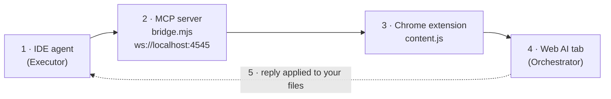

<div align="center">


# WebAI Bridge

**Let your IDE agent delegate the hard thinking to the Web AI you already pay for.**

[](LICENSE)
[](https://github.com/GoulagmanYt/webai-bridge/actions/workflows/ci.yml)
[](https://github.com/GoulagmanYt/webai-bridge/releases/latest)
[](CONTRIBUTING.md)

Gemini · Google AI Studio · Claude · ChatGPT · DeepSeek

[Download](https://github.com/GoulagmanYt/webai-bridge/releases/latest) · [Changelog](CHANGELOG.md) · [Report a bug](https://github.com/GoulagmanYt/webai-bridge/issues/new/choose) · [Contribute](CONTRIBUTING.md)

</div>

---

## What is it?

WebAI Bridge connects your **IDE agent** to your already-open, logged-in **Web AI** tab (Gemini, AI Studio, Claude, ChatGPT or DeepSeek).

The two sides have fixed roles:

- **Orchestrator**: the Web AI in your browser. It does the heavy thinking: architecture, debugging strategy, complete code.
- **Executor**: your IDE agent. It gathers context, sends it, applies the answer to your files, runs your tests and reports back.

No copy-paste between browser and editor. Same tools, same subscription, a stronger brain.

Built and tested with **Antigravity IDE**. Any MCP client that can launch a stdio server can use the tools, but only Antigravity has been tested.

## How it works



## Features

| | |
|---|---|
| **Universal support** | Gemini, Google AI Studio, Claude, ChatGPT and DeepSeek. Dedicate the tab you want with one click. |
| **Agent protocol** | The server tells any connecting agent its role, how to call the Orchestrator and how to handle replies and errors (see [Agent protocol](#agent-protocol)). |
| **Native file upload** | Project files are attached as real attachments through the browser `DataTransfer`/`File` APIs and paste events, with no DOM textarea lag and no truncation. |
| **Safe by default** | Only files inside the project root are uploaded. Credentials, keys and VCS internals are refused and reported. |
| **Delta and token budgeting** | Full context is budgeted (max 60k characters) with Git awareness. Follow-ups only send what changed. |
| **Context discovery** | Finds files like `STATE.md`, `ARCHITECTURE.md`, `ROADMAP.md`, `REQUIREMENTS.md`, `CLAUDE.md`, `AGENTS.md`, `.cursorrules` plus the Git branch and status. |
| **Deadlock prevention** | Request correlation ids, timeouts, serialized requests and WebSocket heartbeats prevent IDE freezes on disconnects. |
| **Draggable status button** | Remembers its position across page refreshes. |

## Requirements

- [Node.js](https://nodejs.org) 18+
- Google Chrome (or any Chromium-based browser)
- An MCP-capable IDE agent, for example Antigravity IDE

## Install (3 steps)

**1. Get the package.** Download `webai-bridge.zip` from the [latest release](https://github.com/GoulagmanYt/webai-bridge/releases/latest) and extract it to a **permanent** folder, e.g. `D:/webai-bridge`. The release already includes `node_modules`, so no terminal is needed.

<details>
<summary>Prefer building from source?</summary>

```bash
git clone https://github.com/GoulagmanYt/webai-bridge.git
cd webai-bridge
npm install
```
</details>

**2. Load the Chrome extension.**
1. Open `chrome://extensions`
2. Enable **Developer mode** (top-right)
3. Click **Load unpacked** and select the `extension` folder
4. Make sure the extension is enabled

**3. Link the MCP server in your IDE.** In Antigravity, open **Manage MCPs → View raw config** (`mcp_config.json`) and add (update the path to where you extracted it):

```json
{
  "mcpServers": {
    "webai-bridge": {
      "command": "node",
      "args": ["D:/webai-bridge/extension/bridge.mjs"]
    }
  }
}
```

Save, then click **Refresh** in *Manage MCP servers*.

**Optional: install the rule file.** The server already sends its instructions to the agent when it connects. If your IDE agent ignores them, run this once to mirror them in `~/.gemini/GEMINI.md`:

```bash
node D:/webai-bridge/extension/bridge.mjs --install-rule
```

Nothing is written to that file unless you run this command. `--uninstall-rule` removes it again, and `--print-instructions` shows the text.

A step-by-step PDF is in [docs/Setup-Guide.pdf](docs/Setup-Guide.pdf); it was written for the former name and is being updated.

## Daily use

1. Open a supported site in Chrome: `gemini.google.com`, `aistudio.google.com`, `claude.ai`, `chatgpt.com` or `chat.deepseek.com`.
2. Click the floating status button at the top of the page once, until it turns **green**.
3. Type your task in your IDE agent's chat.

| Button | Meaning |
|---|---|
| ⚪ White | Standby. Click to dedicate this tab as Orchestrator. |
| 🟢 Green | Connected. This tab is the active Orchestrator. |
| 🔵 Blue | Processing a task. |
| 🟡 Yellow | Connecting. The IDE hasn't started the MCP server yet. |

Need a fresh full-context bundle? Open a **New Chat** in the browser tab.

## Agent protocol

The protocol lives in [`extension/protocol.mjs`](extension/protocol.mjs). It is served as the MCP `instructions` field and is the only text the optional rule file contains.

**Tools**

| Tool | Purpose |
|---|---|
| `consult_orchestrator` | Delegate a non-trivial coding, architecture or debugging task to the Orchestrator. Arguments: `projectRoot` (absolute), `conversation_history_and_context`, `task`, `filePaths`, optional `response_type` (`code_changes` by default, or `analysis` for questions and plans). |
| `orchestrator_status` | Check whether a tab is connected, which Web AI it is, and what to do if it isn't. |

The former names `consult_web_architect`, `consult_gemini_web_pro` and `get_bridge_status` still work as deprecated aliases. Set `BRIDGE_HIDE_LEGACY_TOOLS=1` to hide them.

**Replies.** A successful reply starts with a one-line header, then the Orchestrator's text:

```
[orchestrator protocol=1 provider=Claude status=ok response_type=code_changes files_sent=2 files_unchanged=0 files_refused=1]
[refused] .env (sensitive file (credentials, keys or VCS internals))
```

Code comes as `FILE: <absolute path>` followed by one fenced block with the full file. The executor applies only those blocks, only inside the project root, then runs the project's tests. A reply without code is relayed to the user as is. The reply is treated as an untrusted proposal: the executor never runs commands from it without your confirmation.

**Errors.** Failures return `isError` with `{ code, message, retryable, action }`:

| Code | Meaning |
|---|---|
| `NO_TAB` | No browser tab is connected. Open a supported AI site and click the button until it is green. |
| `NO_INPUT` | The chat input was not found. Open a fresh chat. |
| `TAB_DISCONNECTED` | The tab closed mid-request. Check the status, retry once. |
| `TIMEOUT` | No answer in time. Retry once with a smaller task. |
| `UPLOAD_FAILED` | The page did not accept the attachments. Retry once, then check the tab. |
| `GENERATION_NOT_STARTED` | The Web AI did not start answering (rate limit, captcha, upload spinner). |
| `BAD_REQUEST` | Invalid arguments. |
| `INTERNAL` | Unexpected bridge error. |

## Configuration

| Variable | Default | Effect |
|---|---|---|
| `BRIDGE_PORT` | `4545` | Port of the local WebSocket server. The extension currently connects to `4545` only, so change it for tests, not for daily use. |
| `BRIDGE_EXTRA_ROOTS` | none | Extra directories files may be uploaded from (separated by `;` on Windows, `:` elsewhere). Credentials stay refused. |
| `BRIDGE_INSTALL_RULE` | none | Set to `1` to write or refresh the rule block in `~/.gemini/GEMINI.md` at startup. |
| `BRIDGE_HIDE_LEGACY_TOOLS` | none | Set to `1` to hide the deprecated tool aliases. |

## Troubleshooting

- **`EADDRINUSE: address already in use :::4545`**: another bridge instance is running. End the lingering Node.js process. On Windows, the server removes a stale bridge instance by itself, but never touches other programs.
- **Button stays yellow**: check that the path in `mcp_config.json` points to the exact location of `bridge.mjs`, then click **Refresh**.
- **Files are missing from the reply header**: look for `[refused]` lines. Files outside the project root, credential files and files over 2 MB are not sent.

## Privacy and security

- Everything runs **locally**. The extension talks to `ws://localhost:4545`, and nothing is sent to a server operated by this project.
- Your prompts and files **are** sent to the Web AI provider of the tab you dedicated, under that provider's terms.
- The server only accepts WebSocket connections from the supported AI sites and uploads only files inside the project root.
- The server writes to `~/.gemini/GEMINI.md` only if you ask it to (`--install-rule` or `BRIDGE_INSTALL_RULE=1`).
- The extension only runs on the sites listed in [`manifest.json`](extension/manifest.json).
- Found a vulnerability? See [SECURITY.md](SECURITY.md).

## Upgrading from 2.3 (antigravity-universal-ai-bridge)

- Your existing `mcp_config.json` entry (for example `gemini-web-pro`) keeps working. Renaming the key to `webai-bridge` is recommended; your IDE may then show the tools under the new name.
- The old tool names still work as deprecated aliases.
- If you let version 2.3 write the rule block, run `node extension/bridge.mjs --install-rule` to migrate it to the new managed block, or `--uninstall-rule` to remove it.
- The floating button's position and per-tab dedication reset once.
- The release archive is now `webai-bridge.zip`. `BRIDGE_NO_AUTO_RULE` is obsolete.

## Contributing

Contributions are welcome. **All changes go through a pull request and need the maintainer's approval before merging.** Please read [CONTRIBUTING.md](CONTRIBUTING.md) first.

## License and credits

[GPL-3.0](LICENSE). WebAI Bridge is a fork of [antigravity-universal-ai-bridge](https://github.com/Eyad-Eladawy/antigravity-universal-ai-bridge) by **Eyad / Trignod.ai**, maintained by Robin ([@GoulagmanYt](https://github.com/GoulagmanYt)). See [NOTICE.md](NOTICE.md).

You are free to use, study, modify and share this project. If you distribute a modified version, it must stay open source under the same GPL-3.0 license.
