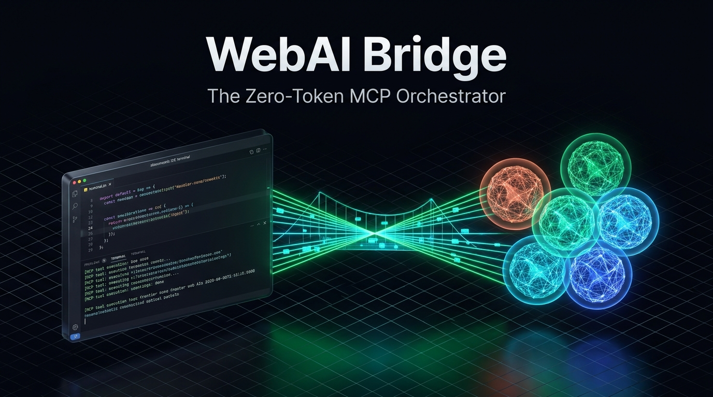
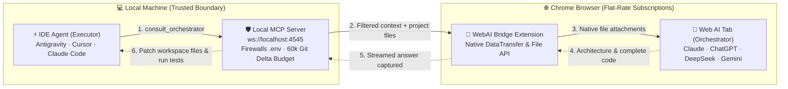

<div align="center">



# WebAI Bridge
### The Zero-Token MCP Orchestrator

**Stop paying twice for AI. Connect your IDE agent directly to your flat-rate Claude, ChatGPT, Gemini, and DeepSeek web subscriptions via MCP — $0 API token cost, native file uploads, zero copy-paste.**

[](https://github.com/GoulagmanYt/webai-bridge/stargazers)
[](LICENSE)
[](https://github.com/GoulagmanYt/webai-bridge/actions)
[](https://github.com/GoulagmanYt/webai-bridge/releases/latest)
[](#-the-double-billing-trap)
[](https://modelcontextprotocol.io/)
[](CONTRIBUTING.md)

<p align="center">
  
  
  
  
  
</p>

[⚡ Quickstart (30s)](#-quickstart-in-30-seconds) · [🥊 Why WebAI Bridge?](#-why-webai-bridge) · [🧠 Frontier Models](#-supported-frontier-models) · [📐 Architecture](#-how-it-works) · [🔒 Security FAQ](#-security-privacy--anti-ban-faq) · [📦 Releases](https://github.com/GoulagmanYt/webai-bridge/releases/latest)

</div>

---

## 🥊 Why WebAI Bridge?

### 💸 The Double-Billing Trap
As developers, we already pay **$20 to $40/month** for subscriptions like **Claude Pro**, **ChatGPT Plus**, or **Gemini Advanced**. 

Yet, when using coding agents inside editors (Antigravity IDE, Cursor, Claude Code, Cline, Roo Code), we are forced to **pay again on a per-token API meter** — burning $10 to $50+ on a single deep debugging session or architecture redesign.

**WebAI Bridge eliminates this dilemma.** It lets your local IDE agent delegate the hard thinking to your logged-in web browser tab over the official **Model Context Protocol (MCP)**.

### 🎭 Fixed Two-Agent Architecture
* **Executor (Local IDE Agent):** Runs in your editor. Gathers local context, invokes tests, inspects syntax, and applies code edits.
* **Orchestrator (Browser Web AI):** Runs in your browser. Acts as the Chief Architect. Solves hard reasoning, plans multi-file structures, and crafts complete solutions.

---

## ⚡ Comparison: Why It Wins

| Feature | Manual Copy-Paste | IDE Pay-Per-Token API | 🚀 WebAI Bridge |
|---|:---:|:---:|:---:|
| **Token Cost** | $0 (included in sub) | **💸 $10 – $100+ / week** | **🎉 $0 (uses your existing flat-rate sub)** |
| **Project File Upload** | Tedious, manual, truncated | Automated, but paid per token | **⚡ Native browser DataTransfer / File API** |
| **Context Management** | Painful manual re-pasting | Full re-read costs token fees | **🧠 Git-aware 60k delta tracking** |
| **Secrets Protection** | High human error risk | Depends on client config | **🛡️ Automatic firewall: refuses `.env` & credentials** |
| **Code Application** | Copy-paste file-by-file | Auto-applied in editor | **⚡ Auto-applied to workspace + auto test runs** |
| **Frontier Models** | Instant web availability | Wait for API access & pay tiers | **✨ Instant Day-0 access to all latest models** |

---

## 🎬 Show, Don't Tell (10-Second Demo)

```
[ IDE Split-Screen: Antigravity / Cursor ]              [ Browser Tab: Claude Opus 5.5 / GPT-6 Astra / DeepSeek V4-Pro ]
  1. User prompts: "Refactor auth system"
  2. IDE Agent invokes consult_orchestrator  -------->   3. Floating status button turns Blue
                                                        4. Project files natively attached (DataTransfer API)
                                                        5. .env & secret keys automatically blocked
  7. Code applied & tests pass automatically <--------   6. Web AI outputs architecture & complete code files
```

> **Result:** 0 Copy-Paste. $0 API Tokens. Pure Autonomous Orchestration.

---

## 🧠 Supported Frontier Models (November 2026 Lineup)

WebAI Bridge connects directly to whatever model is selected in your open browser tab. In November 2026, the frontier AI landscape has unified around **multimodality, 1M+ token context windows, and adjustable Thinking tiers**. Because WebAI Bridge interacts with your real browser session, **any new model, reasoning level, or preview launched on these platforms is supported on Day 0 with zero extension updates:**

### 1. OpenAI — ChatGPT (`chatgpt.com`)
OpenAI structures its web ecosystem around **GPT-6 & GPT-6.1** (unifying the former GPT-4o and o1/o3 lines) with an explicit Thinking selector (*Instant, Medium, High, Extra High*):
* **GPT-6 Astra (and GPT-6 Pro / Astra Ultrafast):** Flagship model launched in September 2026. Dedicated to heavy reasoning, deep software architecture, and complex agentic refactoring.
* **GPT-6.1 Sol (and GPT-6 Sol):** Default daily driver for paid accounts (Plus, Pro, Work, Codex), hyper-optimized for everyday coding and test execution.
* **GPT-6.1 Terra:** Balanced intermediate model (ChatGPT Work & Codex) offering an optimal balance between execution speed and precision.
* **GPT-6 Luna (and GPT-5.6 Luna):** Lightweight, high-speed engine serving as the default for free accounts.

### 2. Anthropic — Claude (`claude.ai`)
Anthropic powers claude.ai with **Claude 5.5** alongside its advanced research branch **Fable / Mythos**, all featuring 1M token context windows and **Adaptive Thinking**:
* **Claude Opus 5.5:** Flagship model for autonomous agentic code generation and massive multi-file refactorings (included with Claude Pro).
* **Claude Fable 5.1 (Mythos 5 class):** Frontier model positioned above Opus (on claude.ai & Max tier), engineered for complex scientific reasoning and long-horizon autonomous tasks.
* **Claude Sonnet 5.5:** Versatile default daily workhorse, 30% faster than Sonnet 5 for full-stack engineering.
* **Claude Haiku 5.5:** Compact, ultra-low-latency model tailored for subagents and high-volume background tasks.

### 3. Google — Gemini (`gemini.google.com`) & Google AI Studio (`aistudio.google.com`)
Google transitions to **Gemini 4**, with **Flash 3.8** acting as its core agentic powerhouse:
* **Gemini 4 Argon (`gemini-4-argon`):** New flagship reasoning model (deployed October 2026 on Gemini Pro/Ultra, AI Studio, and Antigravity) specialized in complex software engineering.
* **Gemini 3.8 Flash (`gemini-3.8-flash` & `3.8 Live Extended Thinking`):** Default Agentic Flash model in AI Studio (superseding 3.5/3.7 Flash), blisteringly fast on code synthesis.
* **Gemini 3.1 Pro Preview (with Deep Think):** Tailored for dense data analysis, mathematics, and Deep Research Max.
* **Gemini 3.5 Flash-Lite (and 3.1 Flash-Lite):** High-throughput lightweight tier for secondary validation.

### 4. DeepSeek — DeepSeek Chat (`chat.deepseek.com`)
DeepSeek has unified its architecture into the **DeepSeek V4 / V4.1** generation (1M tokens context, 100% free on web chat):
* **DeepSeek V4.1-Flash:** 552B MoE native multimodal model (text & vision) featuring the **DeepThink** button, outperforming V4-Pro on agent benchmarks.
* **DeepSeek V4-Pro:** 1.6T parameter heavy reasoning model with 3 selectable thinking levels (*Non-Think, Think High, Think Max*).

---

### 📊 Frontier Web Models Matrix

| Web Platform | Reasoning / Flagship Model | Daily Coding Model | Fast / Lightweight Model | Max Context |
|---|---|---|---|:---:|
| **Claude** | Claude Opus 5.5 / Fable 5.1 | Claude Sonnet 5.5 | Claude Haiku 5.5 | **1M tokens** |
| **Gemini & AI Studio** | Gemini 4 Argon / 3.1 Pro | Gemini 3.8 Flash | Gemini 3.5 Flash-Lite | **1M tokens** |
| **ChatGPT** | GPT-6 Astra / GPT-6 Pro | GPT-6.1 Sol / Terra | GPT-6 Luna | **1.05M tokens** |
| **DeepSeek** | DeepSeek V4-Pro (Think Max) | DeepSeek V4.1-Flash | DeepSeek V4.1-Flash | **1M tokens** |

> [!TIP]
> **Switch brains mid-task in 1 second:** Open tabs for Claude Opus 5.5, GPT-6 Astra, and DeepSeek V4-Pro. Click the floating button on whichever tab you want active — it turns **Green** instantly. No IDE restarts or config file changes needed!

---

## 📐 How It Works



---

## ⚡ Quickstart in 30 Seconds

### Step 1: Get the Package
Download `webai-bridge.zip` from the [latest release](https://github.com/GoulagmanYt/webai-bridge/releases/latest) and unzip it into a permanent folder (e.g. `D:/webai-bridge` or `~/webai-bridge`).  
*(The release bundle already includes pre-built dependencies, no terminal build needed).*

<details>
<summary>Or clone from source</summary>

```bash
git clone https://github.com/GoulagmanYt/webai-bridge.git
cd webai-bridge
npm install
```
</details>

---

### Step 2: Load the Chrome Extension
1. Open `chrome://extensions` in Google Chrome (or Brave, Edge, Chromium).
2. Toggle **Developer mode** (top-right).
3. Click **Load unpacked** and select the `extension` folder inside this repository.
4. Ensure the extension is enabled.

---

### Step 3: Connect Your IDE Agent (MCP Config)

WebAI Bridge supports any MCP client that connects to standard I/O (stdio). Choose your editor:

<details open>
<summary><b>Antigravity IDE</b></summary>

Open **Manage MCPs → View raw config** (`mcp_config.json`) and add:

```json
{
  "mcpServers": {
    "webai-bridge": {
      "command": "node",
      "args": ["D:/webai-bridge/extension/bridge.mjs"]
    }
  }
}
```
*(Update `D:/webai-bridge` to your actual installation path).* Save and click **Refresh**.

**Optional (Agent Instructions):** To mirror the bridge protocol rules directly in `~/.gemini/GEMINI.md`:
```bash
node D:/webai-bridge/extension/bridge.mjs --install-rule
```
</details>

<details>
<summary><b>Cursor</b> (<code>.cursor/mcp.json</code>)</summary>

Add to your project's `.cursor/mcp.json` or global cursor settings:

```json
{
  "mcpServers": {
    "webai-bridge": {
      "command": "node",
      "args": ["D:/webai-bridge/extension/bridge.mjs"]
    }
  }
}
```
</details>

<details>
<summary><b>Claude Code CLI</b></summary>

Register the server with a single terminal command:

```bash
claude mcp add webai-bridge node D:/webai-bridge/extension/bridge.mjs
```
</details>

<details>
<summary><b>Cline / Roo Code (VS Code Extension)</b></summary>

Add to `cline_mcp_settings.json`:

```json
{
  "mcpServers": {
    "webai-bridge": {
      "command": "node",
      "args": ["D:/webai-bridge/extension/bridge.mjs"],
      "disabled": false,
      "autoApprove": []
    }
  }
}
```
</details>

---

## 🚦 Daily Workflow

1. Open your AI website of choice in Chrome:
   * [claude.ai](https://claude.ai)
   * [chatgpt.com](https://chatgpt.com)
   * [chat.deepseek.com](https://chat.deepseek.com)
   * [gemini.google.com](https://gemini.google.com)
   * [aistudio.google.com](https://aistudio.google.com)
2. Click the floating button at the top of the tab until it turns **🟢 Green**.
3. Prompt your IDE agent naturally — it delegates the heavy lifting autonomously!

| Indicator | Status | Action |
|:---:|---|---|
| ⚪ **White** | **Standby** | Click once to dedicate this tab as active Orchestrator. |
| 🟢 **Green** | **Connected** | Active & ready! Tab will handle requests. |
| 🔵 **Blue** | **Processing** | Files uploaded, generating thinking & code. |
| 🟡 **Yellow** | **Connecting** | IDE has not launched the MCP server yet or port is waiting. |

> [!TIP]
> **Need a clean slate?** Open a **New Chat** in the web tab. WebAI Bridge automatically detects new conversations and sends fresh context bundles!

---

## 🛡️ Agent Protocol Specification

The protocol definition lives in [`extension/protocol.mjs`](extension/protocol.mjs) and is served via the standard MCP `instructions` capability.

### Tools

| Tool | Parameters | Description |
|---|---|---|
| `consult_orchestrator` | `projectRoot` *(required)*<br/>`conversation_history_and_context` *(required)*<br/>`task` *(required)*<br/>`filePaths` *(array of paths)*<br/>`response_type` (`code_changes` \| `analysis`) | Delegates a non-trivial architectural, refactoring, or debugging task to the Web AI Orchestrator. Attaches project files natively, returns structured replies. |
| `orchestrator_status` | *(none)* | Checks connectivity, reports active provider and model readiness, and returns recovery instructions if disconnected. |

### Structured Reply Format
Successful replies begin with an envelope header followed by the Orchestrator's structured output:

````text
[orchestrator protocol=1 provider=Claude status=ok response_type=code_changes files_sent=3 files_unchanged=0 files_refused=1]
[refused] .env (sensitive file (credentials, keys or VCS internals))

FILE: /path/to/project/src/auth.ts
```ts
// Full rewritten code
```
````

The IDE Executor strictly parses `FILE: <path>` blocks, applies modifications only inside `projectRoot`, and runs test suites to verify.

### Protocol Error Handling

| Error Code | Description | Automated Recovery Action |
|---|---|---|
| `NO_TAB` | No browser tab dedicated. | Prompt user to open supported AI tab and click the button until green. |
| `NO_INPUT` | Chat textarea not found. | Open a fresh new chat in the browser tab. |
| `TAB_DISCONNECTED` | Tab closed mid-request. | Check status and retry once. |
| `TIMEOUT` | Generation deadline exceeded. | Resumes stream automatically via `jobId` or retry with smaller task. |
| `UPLOAD_FAILED` | File attachment failed. | Clear textarea, retry once with clean state. |
| `GENERATION_NOT_STARTED`| Blocked by captcha, rate limit or upload spinner. | Prompt user to inspect the browser tab. |
| `BAD_REQUEST` | Arguments validation failed. | Fix parameters according to schema. |

---

## ⚙️ Configuration

| Environment Variable | Default | Purpose |
|---|:---:|---|
| `BRIDGE_PORT` | `4545` | Port for the local WebSocket bridge. |
| `BRIDGE_EXTRA_ROOTS` | *none* | Additional allowed directories for file uploads (separated by `;` on Windows, `:` elsewhere). |
| `BRIDGE_INSTALL_RULE` | *none* | Set to `1` to automatically install the agent protocol into `~/.gemini/GEMINI.md`. |
| `BRIDGE_HIDE_LEGACY_TOOLS`| *none* | Set to `1` to hide deprecated alias tools. |

---

## 🔒 Security, Privacy & Anti-Ban FAQ

### Can my Claude / ChatGPT / Gemini account get banned?
**No.** WebAI Bridge does not use reverse-engineered endpoints, private auth tokens, or headless scrapers (Puppeteer/Playwright) which Cloudflare flags. It operates as an extension inside your authentic, everyday browser session at a normal human pace (a few architectural queries per hour).

### Can my `.env` files or secret keys leak?
**Never.** The MCP server enforces a strict local file firewall:
* Only files located inside `projectRoot` are accepted.
* Any sensitive file matching `.env`, private keys, SSH credentials, tokens, or VCS internals (`.git/`) is **strictly refused and reported** under `[refused]`.
* Individual files over 2 MB are rejected to prevent context pollution.

### Can the Web AI execute destructive shell commands on my machine?
**Impossible by design.** The Orchestrator's reply is treated as an untrusted proposal. The Executor agent only applies clean file blocks inside the project workspace and **never executes shell commands or installs packages** without your explicit consent.

### Does any data pass through third-party servers?
**Zero.** Communication between your IDE and Chrome occurs 100% locally on `ws://localhost:4545`. No intermediary cloud service or telemetry tracker exists.

---

## 📜 License & Credits

Released under the **[GNU General Public License v3.0](LICENSE)**.

* **Original Creator:** [antigravity-universal-ai-bridge](https://github.com/Eyad-Eladawy/antigravity-universal-ai-bridge) by **Eyad (Trignod.ai)**.
* **Maintainer & Lead:** Robin ([@GoulagmanYt](https://github.com/GoulagmanYt)).
* Complete attribution and legal notices are detailed in [NOTICE.md](NOTICE.md).

*Trademarks: Antigravity, Claude, ChatGPT, Gemini, Google AI Studio, and DeepSeek are trademarks of their respective owners. Used here solely to indicate compatibility.*
